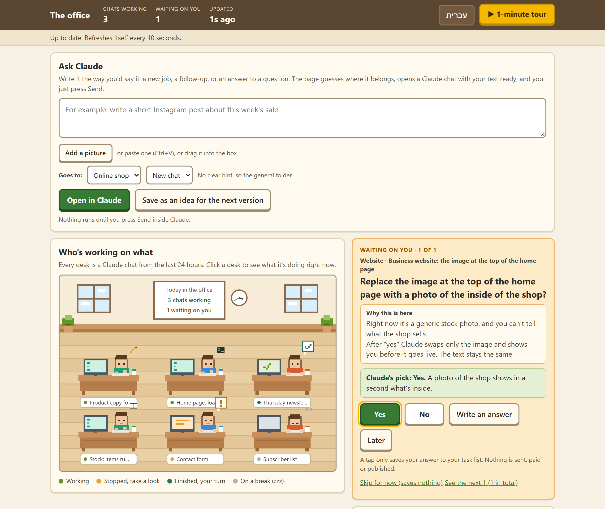
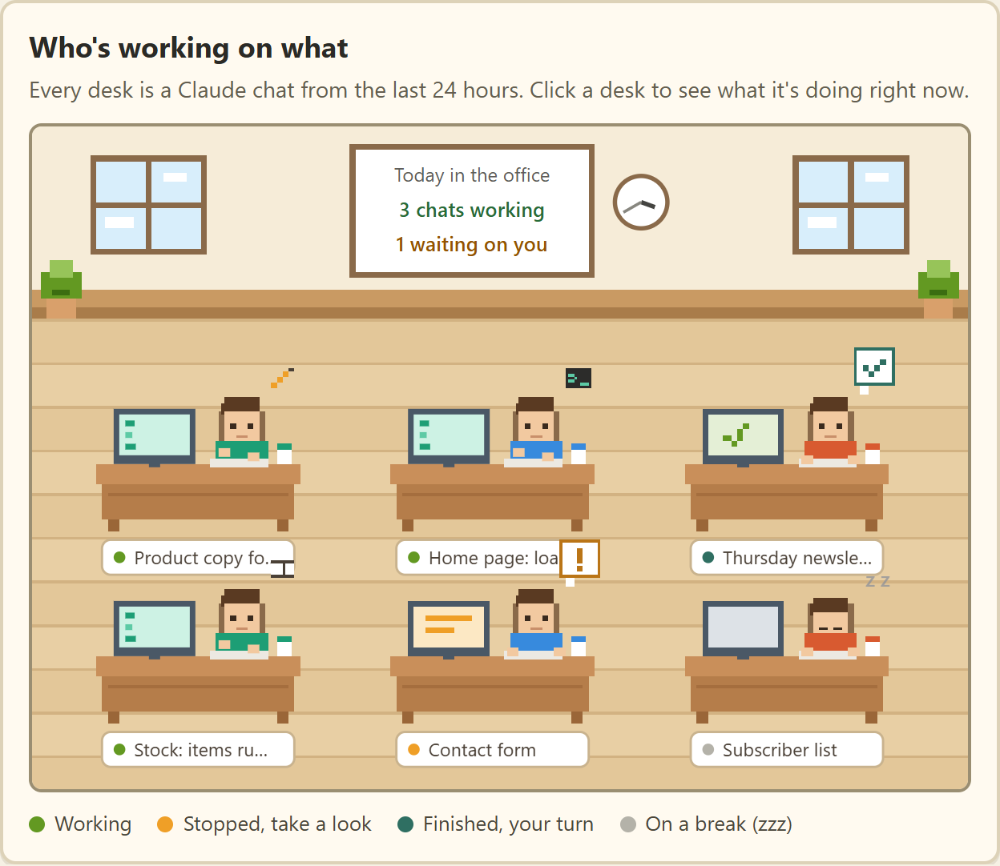
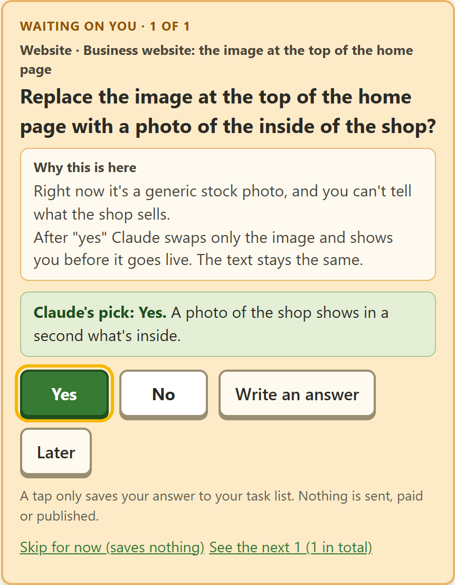
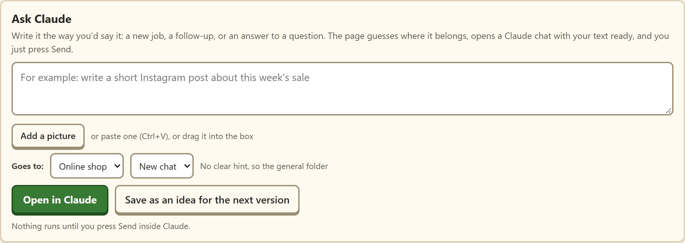
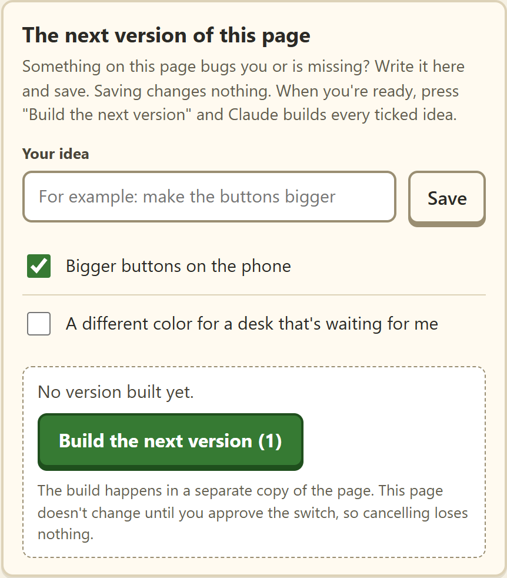

<div align="center">

# 🏢 The Office

**One page that shows all your Claude Code chats.**<br>
Who's working, who got stuck, and what's waiting on you.

[](#install)
[](https://www.python.org/downloads/)
[](https://claude.com/claude-code)
[](#safe)
[](#safe)
[](https://github.com/itsu60ai/claude-office/stargazers)

[עברית](README.md) · **English**

[⚡ Setup](#install) · [✨ Features](#features) · [🔒 What it won't do](#safe) · [💬 Feedback](#feedback)

<br>



</div>

<br>

> 💭 Running a few Claude chats at once? One is writing, one is waiting for your OK, one finished an hour ago and nobody noticed. The Office puts them all on one screen.

<a id="features"></a>

## ✨ What's in it

<table>
<tr>
<td width="50%" valign="top">

<p><b>🪑 A desk for every chat</b></p>


See at a glance what each chat is doing: 🟢 working, 🟠 stopped, 🔵 done and waiting for you.

</td>
<td width="50%" valign="top">

<p><b>✅ One-tap questions</b></p>


Claude needs a decision? It arrives as a card with Claude's pick. Yes, No, or Later.

</td>
</tr>
<tr>
<td colspan="2" valign="top">

<p><b>✍️ Ask Claude</b></p>


Write it in plain words. The page guesses the project and opens a chat with your text ready.

</td>
</tr>
<tr>
<td colspan="2" valign="top">

<p><b>💡 Ideas for the next version</b></p>
<p align="center"></p>

Missing something? Write it down. Press Build, and Claude builds a new version on a separate copy.

</td>
</tr>
</table>

<div align="center">

📷 Up to 4 pictures per request &nbsp;·&nbsp; 🌐 Hebrew and English &nbsp;·&nbsp; 🎨 6 skins, dark mode included &nbsp;·&nbsp; 🔄 Refreshes itself every 10 seconds

</div>

<a id="safe"></a>

## 🔒 What it won't do

| 🚫 Send for you | 🏠 Leave your computer | 💸 Cost money | 🙈 Show private details |
|:---:|:---:|:---:|:---:|
| Every request opens in a chat, and you press Send | Runs only on 127.0.0.1. No account, no outside server | No API key, no AI in the background. It only reads files | Emails, phone numbers and passwords never show on the page |

<a id="install"></a>

## ⚡ Setup in 3 steps

> You need: the Claude desktop app with Claude Code, and [Python 3.8 or newer](https://www.python.org/downloads/).

**1️⃣ Download.** At the top of this page: `Code` → `Download ZIP`, and unzip it wherever you like.

**2️⃣ Start.** Windows: double-click `start.bat`. Mac: right-click `start.command` → Open.
Your browser opens on the office. The black window is the engine, keep it open.

**3️⃣ Set it up.** Open a Claude chat in the office folder and write:

```
Set up my office using the README
```

Claude asks what your projects are and which folder each one lives in, and does the rest. The page picks up the change on its own.

<a id="feedback"></a>

## 💬 Feedback

The office is new, and it gets better from what you tell us. After a few days of use, it takes a minute:

**1️⃣ Press "💬 Feedback"** in the bar at the top of the office.

**2️⃣ Answer three questions.** A rating from 1 to 5, what worked well, and what got stuck or is missing. Answer only the ones you want.

**3️⃣ Press "Send on WhatsApp".** WhatsApp opens with the message ready. Press Send there.

The message goes straight to the person who built the office.

[](https://github.com/itsu60ai/claude-office/issues/new?template=feedback.yml)

## 📚 More details

<details>
<summary><b>🙋 Let Claude leave you questions</b></summary>
<br>

`CLAUDE.md` in this folder tells Claude how to add a question to `tasks.json` and how to read your answer. To make every chat aware of it, ask Claude: "Add the section from the office's CLAUDE.md to my global instructions."

There's a sample in `tasks.example.json`. A question can be written in Hebrew, English or both, and the page shows it in the language you picked. Without a `tasks.json`, the card simply doesn't show.

</details>

<details>
<summary><b>⚙️ What's in office.json, if you'd rather edit it yourself</b></summary>
<br>

| Field | What it sets |
|---|---|
| `officeName` | The name at the top of the page, in Hebrew and English |
| `defaultLang` | `he` or `en`, the language on first open |
| `defaultProject` | The project picked when the page can't guess |
| `newProjectsFolder` | Where Claude checks for, and if needed creates, a new project |
| `projects` | Your projects. Each has `id` (lowercase English), `name`, `nameEn`, `folder`, `color`, `keywords` |
| `privateNames` | Names replaced with an alias, e.g. `{"Dana Cohen": "client"}` |

`keywords` are words separated by `|`, e.g. `shop|products|checkout`. A chat belongs to a project by the folder it was opened in.

</details>

<details>
<summary><b>🔧 When something's off</b></summary>
<br>

- **The page is empty, no desks.** The office shows chats from the last 24 hours. Open a Claude Code chat, write something, and wait a few seconds.
- **"Python was not found".** Install Python from the link above. On Windows, tick "Add Python to PATH" during setup.
- **The port is taken.** Run `python server.py 8780`, then open `http://127.0.0.1:8780`.
- **Mac.** Not tried on a real Mac yet. If no desks show up, let us know.

</details>

<details>
<summary><b>📁 What's in the folder</b></summary>
<br>

| File | What it is |
|---|---|
| `index.html` | The page |
| `server.py` | The engine: reads your chats and tells the page what's happening. Python's built-in libraries only |
| `start.bat` / `start.command` | One-click start for Windows and Mac |
| `office.example.json` | Sample settings. Yours live in `office.json` |
| `tasks.example.json` | Sample questions waiting for you |
| `CLAUDE.md` | Instructions for Claude: setup, questions, feedback |
| `VERSION` | The version number, added to every feedback message |
| `assets/` | The pictures on this page, with made-up data |
| `fonts/` | The skins' fonts, kept here so the page loads nothing from outside. OFL license, see `OFL-*.txt` |
| `state/` | Created on its own: request history, pictures and backups. Never committed |

</details>
