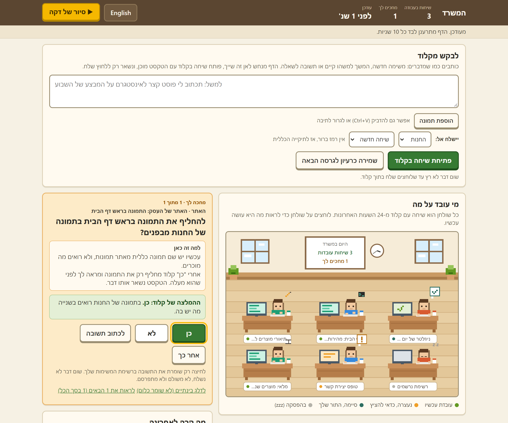
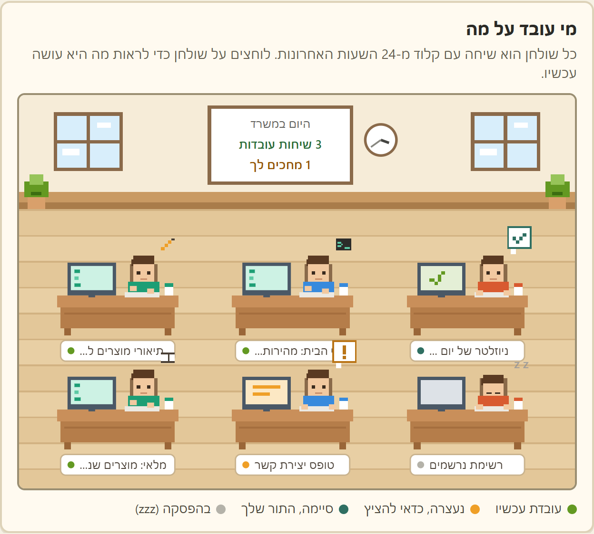
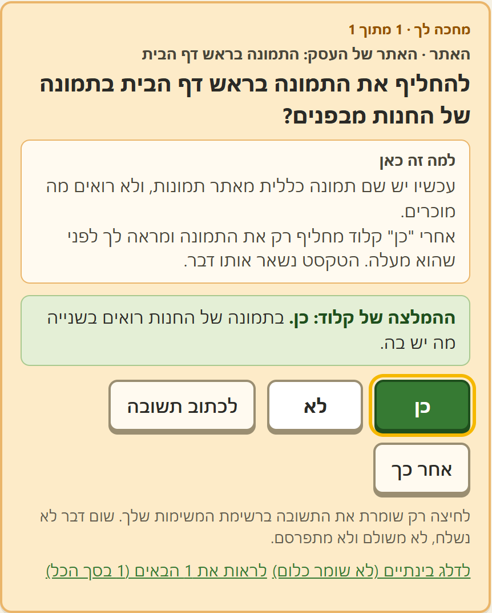
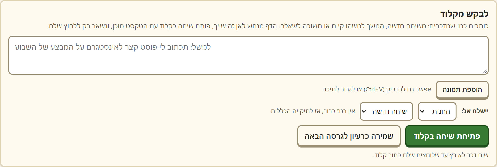
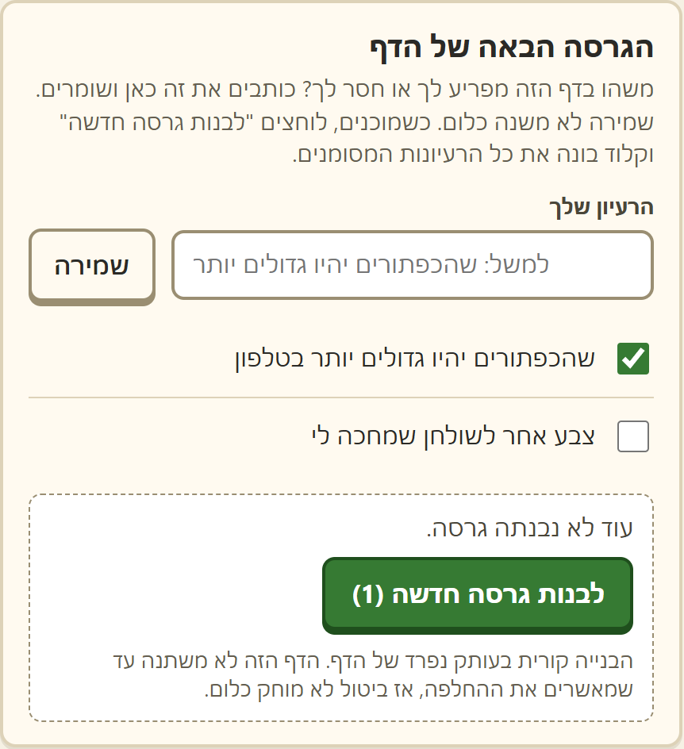

<div align="center">

# 🏢 המשרד

**דף אחד שמראה את כל השיחות שלך עם Claude Code.**<br>
מי עובדת, מי נתקעה, ומה מחכה לך.

[](#install)
[](https://www.python.org/downloads/)
[](https://claude.com/claude-code)
[](#safe)
[](#safe)
[](https://github.com/itsu60ai/claude-office/stargazers)

**עברית** · [English](README.en.md)

[⚡ התקנה](#install) · [✨ מה יש בו](#features) · [🔒 מה הוא לא עושה](#safe) · [💬 פידבק](#feedback)

<br>



</div>

<div dir="rtl">

<br>

> 💭 עובדים עם כמה שיחות של קלוד במקביל? אחת כותבת, אחת מחכה שתאשר, אחת סיימה לפני שעה ואף אחד לא שם לב. המשרד שם את כולן על מסך אחד.

<a id="features"></a>

## ✨ מה יש בו

<table>
<tr>
<td width="50%" valign="top">

### 🪑 שולחן לכל שיחה


רואים במבט מה כל שיחה עושה עכשיו: 🟢 עובדת, 🟠 נעצרה, 🔵 סיימה ומחכה לך.

</td>
<td width="50%" valign="top">

### ✅ שאלות בלחיצה אחת


קלוד צריך ממך החלטה? היא מגיעה ככרטיס עם ההמלצה שלו. כן, לא, או אחר כך.

</td>
</tr>
<tr>
<td width="50%" valign="top">

### ✍️ לבקש מקלוד


כותבים בעברית רגילה. הדף מנחש לאיזה פרויקט זה שייך ופותח שיחה עם הטקסט מוכן.

</td>
<td width="50%" valign="top">

### 💡 רעיונות לגרסה הבאה


חסר לך משהו בדף? רושמים. לוחצים "לבנות", וקלוד בונה גרסה חדשה על עותק נפרד.

</td>
</tr>
</table>

<div align="center">

📷 עד 4 תמונות לבקשה &nbsp;·&nbsp; 📱 עובד בטלפון &nbsp;·&nbsp; 🌐 עברית ואנגלית &nbsp;·&nbsp; 🔄 מתעדכן לבד כל 10 שניות

</div>

<a id="safe"></a>

## 🔒 מה הוא לא עושה

| 🚫 לא שולח בשמך | 🏠 לא יוצא מהמחשב | 💸 לא עולה כסף | 🙈 לא מראה פרטים פרטיים |
|:---:|:---:|:---:|:---:|
| כל בקשה נפתחת אצלך, ואתה לוחץ "שלח" | רץ רק על 127.0.0.1. בלי חשבון ובלי שרת בחוץ | בלי מפתח API ובלי AI ברקע. הוא רק קורא קבצים | מיילים, טלפונים וסיסמאות לא מופיעים בדף |

<a id="install"></a>

## ⚡ התקנה ב-3 צעדים

> צריך: אפליקציית Claude למחשב עם Claude Code, ו-[Python 3.8 ומעלה](https://www.python.org/downloads/).

**1️⃣ מורידים.** למעלה בדף הזה: `Code` ← `Download ZIP`, ופותחים את התיקייה איפה שנוח.

**2️⃣ מפעילים.** ב-Windows לחיצה כפולה על `start.bat`. ב-Mac לחיצה ימנית על `start.command` ← Open.
הדפדפן נפתח על המשרד. החלון השחור הוא המנוע, משאירים אותו פתוח.

**3️⃣ מסדרים.** פותחים צ'אט עם קלוד בתיקייה של המשרד וכותבים:

```
תסדר לי את המשרד לפי ה-README
```

קלוד ישאל מה הפרויקטים שלך ובאיזו תיקייה כל אחד יושב, ויסדר את השאר. הדף קולט את השינוי לבד.

<a id="feedback"></a>

## 💬 פידבק

המשרד עוד חדש, והוא משתפר לפי מה שאתם מספרים. אחרי כמה ימי שימוש, כותבים לקלוד בתיקייה של המשרד:

```
פידבק
```

קלוד ישאל 6 שאלות קצרות, יוריד שמות ופרטים אישיים, ויכין הודעה מוכנה שמתחילה ב-`#פידבק-משרד`. אתם מעתיקים ושולחים למי ששיתף איתכם את המשרד. קלוד לא שולח כלום בעצמו.

[](https://github.com/itsu60ai/claude-office/issues/new?template=feedback.yml)

## 📚 עוד פרטים

<details>
<summary><b>🙋 לתת לקלוד להשאיר לך שאלות</b></summary>
<br>

בקובץ `CLAUDE.md` שבתיקייה יש הוראות לקלוד: איך להוסיף שאלה ל-`tasks.json` ואיך לקרוא את התשובה שלך. כדי שכל השיחות שלך יכירו את זה, אפשר לבקש מקלוד: "תוסיף להוראות הכלליות שלי את הקטע מ-CLAUDE.md של המשרד".

דוגמה יש ב-`tasks.example.json`. כל שאלה אפשר לכתוב בעברית, באנגלית או בשתיהן, והדף יציג אותה בשפה שבחרת. בלי `tasks.json` הכרטיס פשוט לא מופיע.

</details>

<details>
<summary><b>⚙️ מה יש ב-office.json, למי שרוצה לערוך לבד</b></summary>
<br>

| שדה | מה הוא קובע |
|---|---|
| `officeName` | השם בראש הדף, בעברית ובאנגלית |
| `defaultLang` | `he` או `en`, השפה בפתיחה הראשונה |
| `defaultProject` | הפרויקט שנבחר כשהדף לא מצליח לנחש |
| `newProjectsFolder` | איפה קלוד יבדוק, ואם צריך יפתח, פרויקט חדש |
| `projects` | הפרויקטים. לכל אחד: `id` (אותיות קטנות באנגלית), `name`, `nameEn`, `folder`, `color`, `keywords` |
| `privateNames` | שמות שיוחלפו בכינוי, למשל `{"דנה כהן": "לקוחה"}` |

`keywords` הן מילים מופרדות ב-`|`, למשל `חנות|מוצרים|shop`. שיחה משויכת לפרויקט לפי התיקייה שבה היא נפתחה.

</details>

<details>
<summary><b>🔧 כשמשהו לא עובד</b></summary>
<br>

- **הדף ריק, אין שולחנות.** המשרד מציג שיחות מ-24 השעות האחרונות. פותחים שיחה ב-Claude Code, כותבים בה משהו, ומחכים כמה שניות.
- **"Python was not found".** מתקינים Python מהקישור למעלה. ב-Windows מסמנים בהתקנה את "Add Python to PATH".
- **הפורט תפוס.** מריצים `python server.py 8780` ופותחים `http://127.0.0.1:8780`.
- **Mac.** עוד לא בדקנו על Mac אמיתי. אם השולחנות לא מופיעים, ספרו לנו.

</details>

<details>
<summary><b>📁 מה יש בתיקייה</b></summary>
<br>

| קובץ | מה הוא |
|---|---|
| `index.html` | הדף עצמו |
| `server.py` | המנוע: קורא את השיחות ומחזיר לדף מה קורה. רק ספריות שמגיעות עם Python |
| `start.bat` / `start.command` | הפעלה בלחיצה, ל-Windows ול-Mac |
| `office.example.json` | הגדרות לדוגמה. ההגדרות שלך נשמרות ב-`office.json` |
| `tasks.example.json` | דוגמה לשאלות שמחכות לך |
| `CLAUDE.md` | הוראות לקלוד: התקנה, שאלות, פידבק |
| `VERSION` | מספר הגרסה, נכנס לכל פידבק |
| `assets/` | התמונות של הדף הזה, עם נתוני דמה |
| `state/` | נוצרת לבד: היסטוריית הבקשות, התמונות וגיבויים. לא עולה ל-Git |

</details>

</div>
